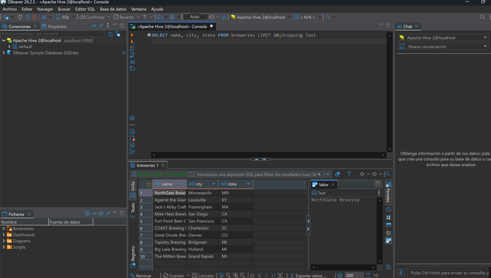
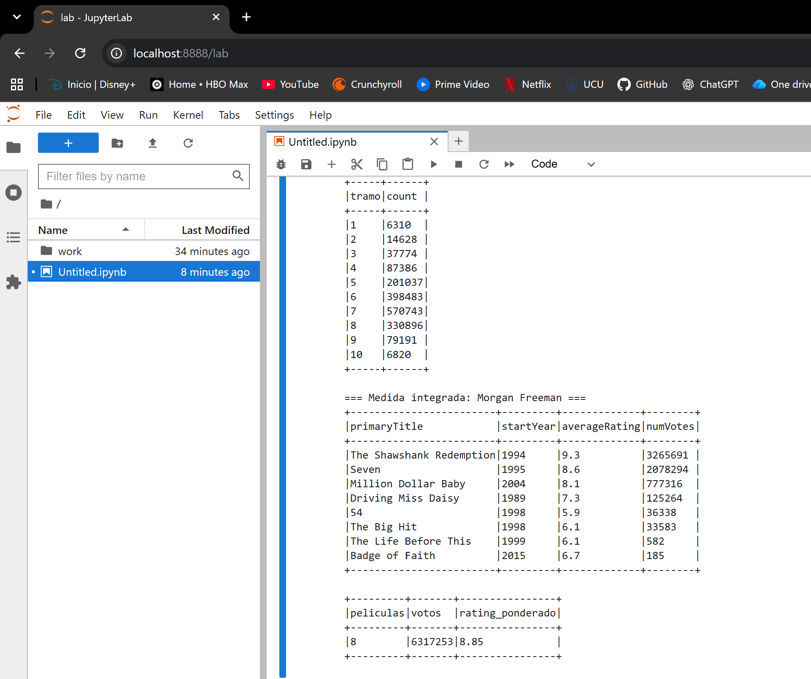

# Práctico HDFS, Hive y Spark

## 1. Preparación del entorno

Se preparó la plataforma Docker del práctico con Hadoop (HDFS y YARN), Hive, Spark y Jupyter. Se agregaron los archivos de configuración requeridos y el dataset `breweries.csv`.

La configuración se validó con `docker compose config` y luego se inició con Docker Compose. La comprobación mostró los servicios activos; Namenode, Datanode, ResourceManager, NodeManager e HistoryServer aparecieron saludables.


## 2. Carga y consulta en Hive

Se copió `breweries.csv` al Namenode, se guardó en HDFS en `/data/openbeer/breweries/breweries.csv` y se creó la base `openbeer`. Luego se definió la tabla externa `breweries` con columnas tipadas para el número de fila, nombre, ciudad, estado e identificador; se omitió la fila de encabezados del CSV.

La consulta muestra diez cervecerías con su ciudad y estado. El resultado confirma que Hive lee la tabla externa ubicada en HDFS.

```sql
SELECT name, city, state
FROM breweries
LIMIT 10;
```



## 3. Exploración y medida con PySpark

Los tres TSV comprimidos se descargaron desde el sitio oficial de IMDb y se leyeron con esquemas explícitos: años y cantidades como enteros, calificaciones como decimal y los demás campos como texto. La ejecución se hizo en JupyterLab dentro de Docker, con Spark 3.3.1 en modo local de cuatro hilos, opción permitida por la consigna. El clúster `spark-master` rechazó la ejecución por los recursos disponibles.

### Exploración de las fuentes

- **`name.basics` (personas):** selección de nombre y profesiones para revisar registros; filtro de personas con profesión de actor o actriz; conteo agrupado de personas y revisión de nulos en año de nacimiento y profesión.
- **`title.basics` (títulos):** selección de identificador, tipo, título y año; filtro de películas recientes (desde 2020); conteo de registros agrupado por tipo de título.
- **`title.ratings` (calificaciones):** selección de identificador, promedio y votos; ordenamiento de títulos con más votos; agrupación por tramo entero de calificación.

Estas transformaciones permitieron reconocer el contenido, la escala, los tipos de títulos y la presencia de datos faltantes antes de cruzar las fuentes.

### Pregunta e indicador

**Pregunta:** ¿Qué calificación ponderada por cantidad de votos tienen las películas de Morgan Freeman identificadas en IMDb?

Se tomaron los títulos asociados a Morgan Freeman en `name.basics` (`knownForTitles`), se enlazaron por `tconst` con `title.basics` y `title.ratings`, y se limitaron los resultados a películas con calificación. El indicador se calculó como:

```
suma(calificación × cantidad de votos) / suma(cantidad de votos)
```

El cruce encontró **8 películas**, con **6.317.253 votos** en total y una calificación ponderada de **8,85**. Entre los resultados aparecen *The Shawshank Redemption* (9,3; 3.265.691 votos), *Se7en* (8,6; 2.078.294) y *Million Dollar Baby* (8,1; 777.316).

El resultado usa la selección `knownForTitles` publicada por IMDb para la persona; no representa necesariamente toda su filmografía ni todos sus créditos actorales.


